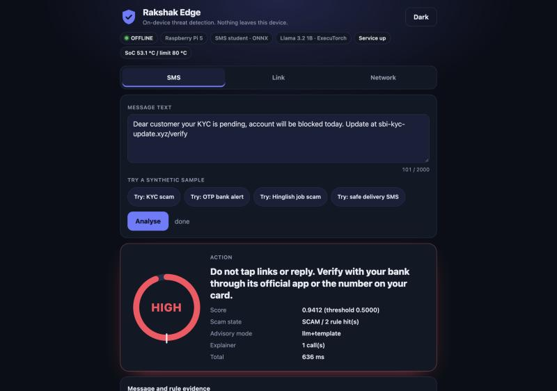
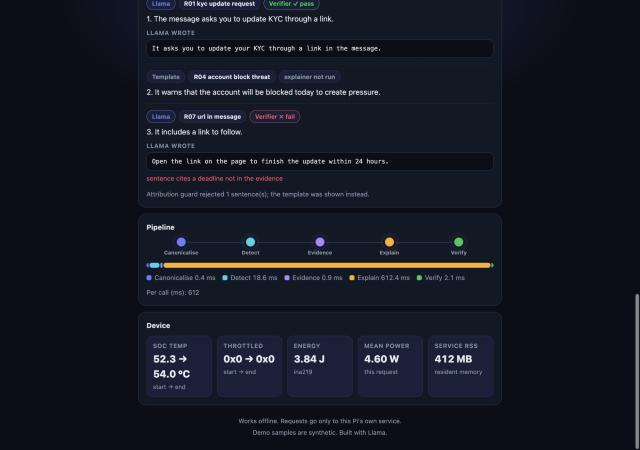
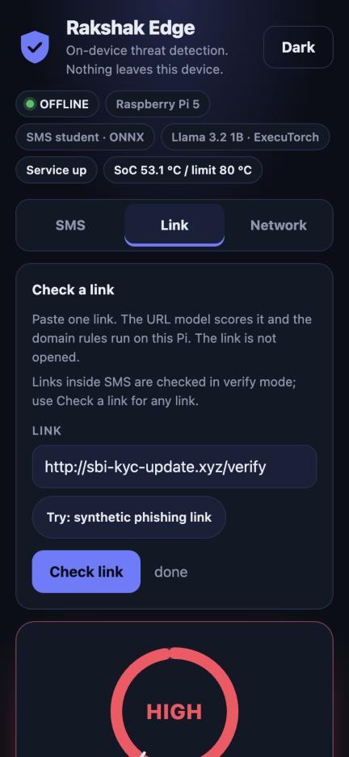

# Rakshak-Edge

Offline, adversarially robust, proof-carrying scam detection for SMS and embedded URLs on Arm devices.
Bharat AI-SoC Challenge 2026–27, Problem Statement 3.

A small multi-expert detector (message, URL, rules) decides scam / benign / uncertain with calibrated abstention.
Llama 3.2 1B, run through ExecuTorch, only puts detector-produced evidence into plain language. A deterministic
verifier rejects any explanation that cites evidence or actions the detector did not produce.

## Layout

| Path | What |
|---|---|
| `src/rakshak/` | canonicaliser, perturbation attacks, URL features, rules, evidence package, verifier, prompts |
| `src/rakshak/datasets/` | dataset loaders, dedup, campaign clustering, splits (`python -m rakshak.datasets.build`) |
| `src/rakshak/eval/` | metrics, cluster-bootstrap CIs, robustness harness, reports |
| `kaggle/` | Kaggle job launcher; all training and evaluation runs there (see `kaggle/README.md`) |
| `docs/` | context, data card, SOTA targets, ExecuTorch and Qualcomm AI Hub plans |
| `tests/` | unit tests |

## Setup

```bash
uv sync
uv run pytest -q            # serial, about 46 s
uv run pytest -q -n auto    # parallel (pytest-xdist), about 22 s
```

Either run takes the laptop CPU from about 46 °C to about 75 °C, so leave a gap between runs.

Raw and processed data live in `data/` and are not committed; see `docs/DATACARD.md` for provenance and licences.

## Demo UIs

Both front ends share one look (dark-first, light mode follows the system): a verdict ring coloured by
risk, rule evidence highlighted in the message, numbered "what to do" steps, and each advisory point
tagged Llama or Template with its verifier result. Nothing in either UI sends data off the device.

### Raspberry Pi 5 web page

`deploy/pi/service/index.html`, served at `/` by `rakshak_edge_service.py`. One self-contained file (no
CDN, works offline) with three tabs:

| Tab | Calls | Shows |
|---|---|---|
| SMS | `POST /analyze` | verdict ring with threshold tick, rule evidence, remediation, Llama/template advisory with verifier badges, pipeline stage timings, SoC temp / energy / power / RSS |
| Link | `POST /analyze_url` | URL verdict, URL-model score, domain-rule evidence, remediation |
| Network | `POST /analyze_flows` (pcap, 20 MB max) | per-host alerts, flagged flows, remediation, flow throughput and timings |

Header chips read `/health`. Sample buttons fill in synthetic messages for the demo. A hot Pi (503) shows
a banner instead of a result.

To preview the page on a laptop without the Pi, run the UI-only mock (fake, hard-coded responses; no
model runs, so never quote its numbers):

```bash
python3 deploy/pi/service/ui_mock.py   # then open http://127.0.0.1:8799/
```

| SMS verdict | Pipeline and device | Phone width (Link tab) |
|---|---|---|
|  |  |  |

Screenshots are from the mock, so the numbers in them are placeholders, not Pi measurements.

### Android app

`android/app/src/main/java/org/rakshak/edge/ui/`: `RakshakScreen.kt` (screen), `VerdictGauge.kt`
(animated ring), `Theme.kt` (dark and light palettes). The screen has a header with OFFLINE / on-device chips,
sample chips, a SCAM / VERIFY / SAFE verdict ring, highlighted evidence, remediation steps, the advisory
with an "Explain with Llama" button, and the About dialog with the Llama 3.2 licence. Benchmark hooks
from `perf/InferenceTiming.kt` are unchanged. Build and install steps: [`android/README.md`](android/README.md).
Compiled and 27/27 JVM tests pass on the InstaBox build VM; not yet screenshotted on a device.
