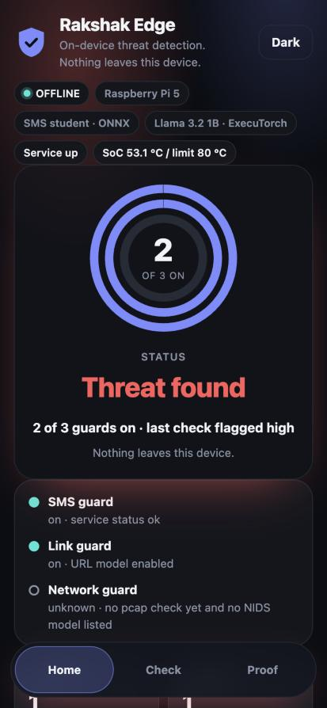

# Rakshak-Edge

Offline, proof-carrying scam detection for SMS and links, running on Arm: an Android phone (arm64-v8a) and a Raspberry Pi 5 (Cortex-A76).
Entry for the **Arm Bharat AI-SoC Challenge 2026–27, Problem Statement 3**.

Nothing leaves the device. The app declares no network permission, and the Pi service runs with no route out.

## Overview

A small detector decides **SCAM**, **UNCERTAIN** or **SAFE**, and abstains when it is not sure. A Llama 3.2 1B explainer
may then write plain-language sentences about the evidence the detector found. A deterministic verifier drops any sentence
that cites evidence or actions the detector did not produce, and a template always stands behind it. The explainer can
never change the verdict.

- **Detector:** SMS char-CNN, URL char-CNN and deterministic rules (fused), plus a rules-first network (NIDS) path on the Pi.
- **Explainer:** Llama 3.2 1B Instruct (SpinQuant INT4) through ExecuTorch.
- **Proof-carrying explanation:** each sentence gets a verifier receipt (verified, or rejected and replaced by a template, with the reason).
- **Honest limits:** known weaknesses are listed in [docs/START_HERE.md](docs/START_HERE.md) under "Known limits". Read them before quoting a number.

Start with [docs/START_HERE.md](docs/START_HERE.md) (what runs where and how ready each part is) and
[docs/RESULTS_INDEX.md](docs/RESULTS_INDEX.md) (every committed result, with its data split).

## Architecture

```
                 SMS / shared text / link / network flows
                                  |
                       canonicaliser (de-obfuscation)
                                  |
        +-------------------------+--------------------------+
        |                         |                          |
   SMS student               URL student                  rules +
   (char-CNN, ONNX)          (char-CNN, ONNX)             evidence extractor
        |                         |                          |
        +------------- fusion + calibrated abstention -------+
                                  |
                     verdict: SCAM / UNCERTAIN / SAFE  +  evidence package
                                  |
        +-------------------------+--------------------------+
        |                                                    |
   remediation steps (fixed text)         Llama 3.2 1B explainer (ExecuTorch)
                                                             |
                                          verifier: drop any sentence citing
                                          evidence the detector did not produce
                                                             |
                                          verified sentences, else template
```

| Part | Where | What |
|---|---|---|
| Core library | `src/rakshak/` | canonicaliser, rules, evidence package, verifier, URL features, fusion, NIDS rules, models |
| Pi 5 service | `deploy/pi/service/` | stdlib HTTP service (`/analyze`, `/analyze_url`, `/analyze_flows`, `/health`) and an offline web page |
| Pi tooling | `deploy/pi/` | install scripts, thermal governor, dashboard, benchmark harness (`bench/`) |
| Android app | `android/` | Kotlin + Compose app, ONNX Runtime detector, ExecuTorch explainer; Python parity tests |
| Training and evaluation | `kaggle/`, `colab/` | job launchers; all training ran on Kaggle or Colab |
| Docs | `docs/` | system description, data card, every result document, plans |
| Tests | `tests/` | Python tests (over 2,000) |

## Models and Arm details

| Model | Format | Size | Runs on |
|---|---|---|---|
| SMS student (dual-view char-CNN, raw and canonical bytes plus 16 rule flags) | ONNX | 388,127 B | Pi 5 and Android, ONNX Runtime |
| URL student (wide char-CNN plus 29 side features) | ONNX | 2,741,232 B | Pi 5 |
| NIDS student (INT8) | ONNX | 6,729 B | Pi 5 (rules decide; the model alone only gives advice) |
| Explainer: Llama 3.2 1B Instruct, SpinQuant INT4 | ExecuTorch `.pte` | 1,135,951,488 B | Pi 5 and Android, ExecuTorch (XNNPACK, Arm CPU) |

Hashes, thresholds and provenance for each file are in [docs/SYSTEM_V1.md](docs/SYSTEM_V1.md) section 1a.

- **Targets:** Raspberry Pi 5 (4 GB, Cortex-A76, run at 2.4 GHz for the benchmarks) and Android `arm64-v8a`, minSdk 28.
- **CPU only.** No GPU or NPU is used. The Pi thermal governor (`deploy/pi/rakshak_thermald.py`) pauses work above a temperature limit.
- **Offline by construction.** `scripts/offline_check.sh` runs the tests in a network namespace with no route and checks that a connect is refused ([docs/OFFLINE_ASSURANCE.md](docs/OFFLINE_ASSURANCE.md)).
- **Model files are not in git** (size and licence). See "Model files" below. The Llama 3.2 licence and attribution are in [`android/app/src/main/assets/rakshak/llama3_2_LICENSE.txt`](android/app/src/main/assets/rakshak/llama3_2_LICENSE.txt).

## Setup

Requires Python 3.11+ and [uv](https://docs.astral.sh/uv/).

```bash
git clone https://github.com/vhmaadhav/rakshak-edge.git
cd rakshak-edge
uv sync --locked                 # exact versions from uv.lock
uv run pytest -q -n auto         # Python tests
uv run ruff check src tests      # lint
```

- The Pi service uses Unix sockets and `fcntl`, so its tests need Linux (or WSL). On Windows those test modules cannot be imported.
- Some tests are skipped when optional packages (torch, nfstream, executorch) or the model files are absent. That is expected.
- Optional, only for training or the live NIDS: `torch`, `transformers`, `executorch`, `nfstream`, `scapy`. They are not in the lock file.
- Raw datasets are not committed. See [docs/DATACARD.md](docs/DATACARD.md) for provenance and licences.

### Model files

Copy the pinned SMS detector into the Android assets before building (checksum in [android/README.md](android/README.md)),
and push the optional Llama files with adb. Pi paths and the sync script are in [deploy/pi/bench/README.md](deploy/pi/bench/README.md).

## Run

### Raspberry Pi 5

```bash
deploy/pi/bench/sync_bench.sh                   # laptop: copy code and pinned model files to the Pi
~/rakshak-bench/deploy/pi/service/start_service.sh   # Pi: starts on 127.0.0.1:8770
curl -s http://127.0.0.1:8770/health
curl -s -X POST http://127.0.0.1:8770/analyze -H 'Content-Type: application/json' \
  -d '{"sms": "Your account is blocked. Verify KYC now at http://example.test/kyc"}'
```

The web page is served at `/` on the same port. Full steps: [docs/START_HERE.md](docs/START_HERE.md).
To preview the page on a laptop without the Pi, run `python3 deploy/pi/service/ui_mock.py` (fake data, never quote its numbers).

For lower latency, start the service with `--response-mode verdict_first` (verdict at once, explanation fetched by ID) and `--workers N`.
Details and operational limits: [docs/PERF_FAST_INFERENCE.md](docs/PERF_FAST_INFERENCE.md).

### Android

```bash
cd android
./gradlew :app:assembleDebug :app:testDebugUnitTest      # needs JDK 17 and the Android SDK
adb install -r app/build/outputs/apk/debug/app-debug.apk # one arm64 phone, USB debugging on
```

Build box, model provisioning and the on-device benchmark harness: [android/README.md](android/README.md).

## Results and benchmarks

Detector numbers come from a campaign-disjoint test split with campaign-clustered confidence intervals
([docs/BASELINE.md](docs/BASELINE.md)). Many rows were used to design rules and thresholds, so only the sets marked independent are fair tests.

| Measure | Result | Source |
|---|---|---|
| SMS F1, campaign-disjoint test (22,145 rows) | 0.9813 [0.9794, 0.9830] (stored run log says 0.9749; unresolved) | [BASELINE.md](docs/BASELINE.md) |
| SMS F1, Hinglish `lang_shift` (1,677 rows) | 0.9860 [0.976, 0.994] | [BASELINE.md](docs/BASELINE.md) |
| SMS recall, SmishX (independent, 226 smishing) | 69.47 % [63.18, 75.11] for the student alone | [BASELINE.md](docs/BASELINE.md) |
| Visible warnings on legitimate policy messages (1,133), quiet mode | 2 (0.18 %); the student alone flags 471 (41.57 %) | [GROUNDLM_EDGE_FPR.md](docs/GROUNDLM_EDGE_FPR.md) |
| URL model, PhreshPhish official test | FPR 0.92 %, recall 92.0 %; weak on other benign URL sources (FPR 69.4 % on `url_domain`) | [URL_SERVICE_RESULTS.md](docs/URL_SERVICE_RESULTS.md) |
| Robustness, 9 perturbation families x 3 seeds | mean recall under attack 0.9803, attack success rate 0.0023 | [BASELINE.md](docs/BASELINE.md) |
| Network, synthetic captures (26 files) | rules first: 11 / 11 attacks found, 1 / 6 benign files alerted; no real traffic tested | [NIDS_EDGE.md](docs/NIDS_EDGE.md) |

**Pi 5 latency** (2.4 GHz, thermal governor stopped, reported in [docs/PERF_FAST_INFERENCE.md](docs/PERF_FAST_INFERENCE.md) and [docs/BASELINE_PI.md](docs/BASELINE_PI.md)):

| Mode | p50 | Note |
|---|---|---|
| Synchronous (verdict plus Llama explanation) | 794 ms to 1.4 s | Llama about 1.1 s to first token |
| Verdict-first (verdict only) | 5.5 ms | 0 verdict flips over 5,080 messages with the FP32 ONNX model |
| Verdict-first throughput | up to 1,050 msg/s | 4 workers, 16 clients, batching |

**Android on-device benchmark:** see [docs/benchmarks.md](docs/benchmarks.md).

Everything else is indexed in [docs/RESULTS_INDEX.md](docs/RESULTS_INDEX.md), and the frozen system description is [docs/SYSTEM_V1.md](docs/SYSTEM_V1.md).

## Demo UIs

Both front ends share one design (graphite theme, three views: **Home**, **Check**, **Proof**). Every number on screen is measured on the device.

- **Proof-carrying explanation:** the verifier receipt lists each Llama sentence and why it was kept or replaced.
- **Air-gap proof (Pi):** reads `/health.network` (interfaces, routes, outbound probe). It says **Sealed** only when the data shows it.
- **Offline proof (Android):** reads the app's requested permissions from `PackageManager` at run time.

| Home | Verdict | Verifier receipt |
|---|---|---|
|  |  |  |

| Air-gap proof | Phone width |
|---|---|
|  |  |

Screenshots are from the mock (`ui_mock.py`), so their numbers are placeholders, not Pi measurements.

## Repository layout

```
src/rakshak/      core library          deploy/pi/    Pi service, tooling, benchmarks
android/          Android app           kaggle/ colab/  training and evaluation jobs
docs/             documents and results  tests/         Python tests
scripts/          release manifest, offline check, data helpers
tools/            inbox export tooling   research_notes/ reports/  background research and plans
```

## Release checks

```bash
python3 scripts/release_manifest.py --out-dir release       # manifest and SHA256SUMS
python3 scripts/release_manifest.py --verify release/release_manifest.json
scripts/offline_check.sh                                    # tests with no network
```

## Team

Team Rakshak-Edge, Bharat AI-SoC Challenge 2026–27 (PS3). Contributors, from the git history:

- Maadhav ([@vhmaadhav](https://github.com/vhmaadhav))
- Sachin A S
- Nakul ([@nakultt](https://github.com/nakultt))

<!-- TODO(team): add each member's role and affiliation before submitting. -->

## Licences

No licence file is committed for the code yet; add one before any public release.
Llama 3.2 is used under the Llama 3.2 Community License; "Built with Llama". Datasets keep their own licences ([docs/DATACARD.md](docs/DATACARD.md)).
