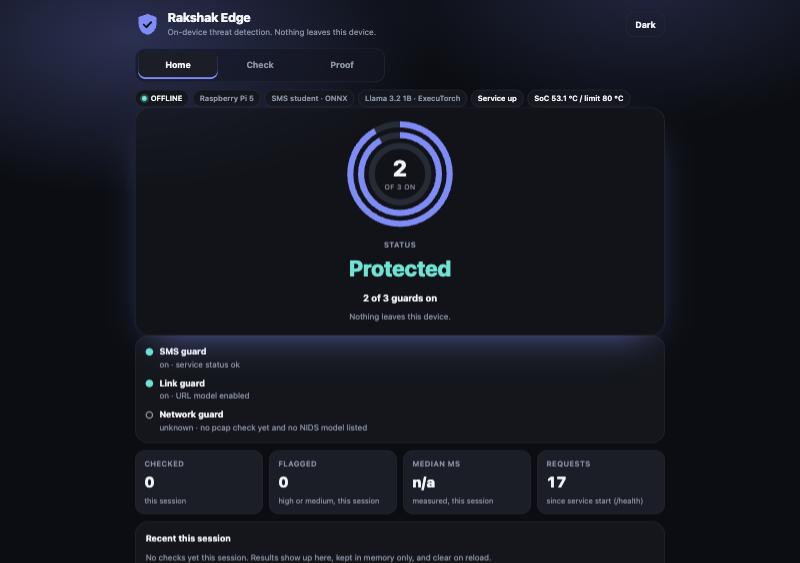
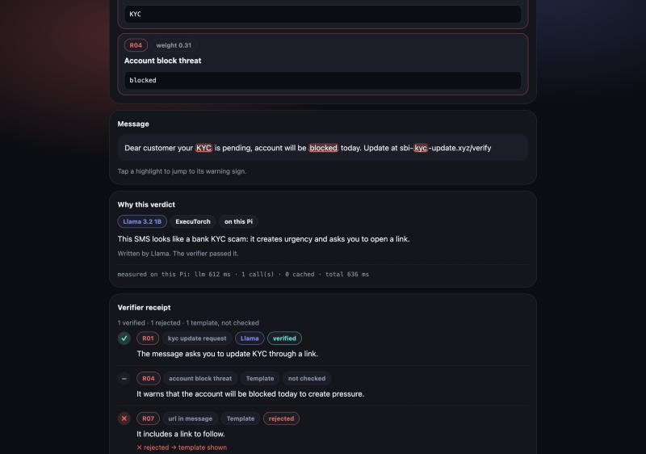
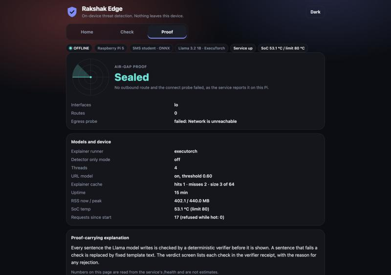

# Rakshak-Edge

Offline, adversarially robust, proof-carrying scam detection for SMS and embedded URLs on Arm devices.
Bharat AI-SoC Challenge 2026–27, Problem Statement 3.

A small multi-expert detector (message, URL, rules) decides scam / benign / uncertain with calibrated abstention.
Llama 3.2 1B, run through ExecuTorch, only puts detector-produced evidence into plain language. A deterministic
verifier rejects any explanation that cites evidence or actions the detector did not produce.

## Layout

| Path | What |
|---|---|
| `src/rakshak/` | canonicaliser, perturbation attacks, URL features, rules, evidence package, verifier, prompts |
| `src/rakshak/datasets/` | dataset loaders, dedup, campaign clustering, splits (`python -m rakshak.datasets.build`) |
| `src/rakshak/eval/` | metrics, cluster-bootstrap CIs, robustness harness, reports |
| `kaggle/` | Kaggle job launcher; all training and evaluation runs there (see `kaggle/README.md`) |
| `docs/` | context, data card, SOTA targets, ExecuTorch and Qualcomm AI Hub plans |
| `tests/` | unit tests |

## Setup

```bash
uv sync
uv run pytest -q            # serial, about 46 s
uv run pytest -q -n auto    # parallel (pytest-xdist), about 22 s
```

Either run takes the laptop CPU from about 46 °C to about 75 °C, so leave a gap between runs.

Raw and processed data live in `data/` and are not committed; see `docs/DATACARD.md` for provenance and licences.

## Demo UIs

Both front ends share one design: graphite dark theme (light follows the system), frosted-glass navigation,
an aurora that tints toward the latest risk, and three views, **Home**, **Check** and **Proof**. Every number
on screen is measured on the device or comes from this session's own results. Nothing is hard-coded, and
nothing in either UI sends data off the device.

What sets them apart:

- **Proof-carrying explanation.** Each Llama sentence is checked by a deterministic verifier. The verdict
  shows a *verifier receipt*: one row per point, marked verified, or rejected and replaced by template text,
  with the reason.
- **Air-gap proof (Pi).** The Proof view reads `/health.network`: interfaces, routes and the outbound
  connect probe. It shows **Sealed** only when the service has no route out and the probe failed.
  Otherwise it shows *Not isolated* or *Not measured*.
- **Offline proof (Android).** The Proof tab reads the app's own requested permissions from
  `PackageManager` at run time: no INTERNET, network-state or SMS permission.
- **Explainable verdict.** A risk ring with a count-up score and a threshold tick, a one-line headline,
  warning-sign chips, the message with risky spans highlighted (on the Pi page, tap one to jump to its sign), the Llama
  "why" card with measured time, and pre-checked "what to do now" steps that are not written by the AI.

### Raspberry Pi 5 web page

`deploy/pi/service/index.html`, served at `/` by `rakshak_edge_service.py`. One self-contained file: no
CDN, no external fonts, works offline. On phones the top tabs become a floating bottom nav.

| View | Calls | Shows |
|---|---|---|
| Home | `GET /health` | guard rings (SMS, Link, Network; lit only when /health shows them usable), Protected / Threat found, this session's checked / flagged / median ms, requests since service start, recent verdicts (in memory only) |
| Check | `POST /analyze` (`lang` auto / en / hinglish), `/analyze_url`, `/analyze_flows` | verdict ring, warning signs, highlighted message, Llama "why", verifier receipt, remediation, pipeline stage ms, SoC temp / energy / power / RSS; link and pcap results |
| Proof | `GET /health` | air-gap radar with interfaces / routes / egress probe; explainer runner, threads, URL model, explainer cache, uptime, RSS |

To preview on a laptop without the Pi, run the UI-only mock. Its responses are fake and hard-coded, and no
model runs, so never quote its numbers:

```bash
python3 deploy/pi/service/ui_mock.py   # then open http://127.0.0.1:8799/
```

| Home | Verdict | Verifier receipt |
|---|---|---|
|  |  |  |

| Air-gap proof | Phone width |
|---|---|
|  |  |

Screenshots are from the mock, so their numbers are placeholders, not Pi measurements.

### Android app

`android/app/src/main/java/org/rakshak/edge/ui/`:

| File | What |
|---|---|
| `RakshakScreen.kt` | Shell with a glass bottom nav (sliding pill, haptic tick), the Check tab, session history kept in memory only |
| `HomeTab.kt` | Guard rings (Detector, Explainer, Offline), session counters, recent verdicts |
| `ProofTab.kt` | Permission proof from `PackageManager`, model status, Built with Llama and the licence |
| `VerdictGauge.kt`, `Components.kt`, `Theme.kt` | Count-up ring, glass cards, chips, canvas icons, palettes |

The Check tab shows the verdict ring, warning signs, highlighted message, the "Explain with Llama" card with
measured time, the verifier receipt, remediation, and "checked in N ms on this phone". A haptic fires when a
verdict lands. The benchmark hooks from `perf/InferenceTiming.kt` are unchanged. Build steps:
[`android/README.md`](android/README.md). It compiles and 27/27 JVM tests pass on the InstaBox build VM.
It has not yet been screenshotted on a device.
